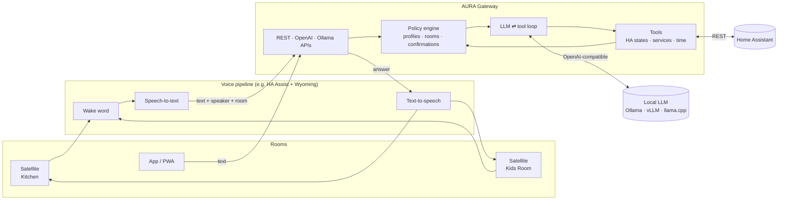

# AURA Gateway

**The local-first brain API of AURA — connecting voice satellites and apps to local LLMs and Home Assistant, with household policies the model can't talk its way around.**

[](https://github.com/r1ckyrockz/aura-gateway/actions/workflows/ci.yml)
[](LICENSE)


---

## What is AURA?

**AURA** stands for **Ambient Unified Residential Assistant**: a private, Siri-like assistant for one household that runs on your own hardware. Think of a HomePod that belongs to you. Nothing you say leaves your network unless you decide it should.

AURA is made of a few parts:

| Part                         | Role                                                                                                                                                          |
| ---------------------------- | ------------------------------------------------------------------------------------------------------------------------------------------------------------- |
| **Satellites**               | Small speaker/microphone devices in each room (wake word, audio in/out, a status display).                                                                    |
| **Voice pipeline**           | Wake word → speech-to-text → _text_ → text-to-speech. Today this can be Home Assistant Assist with Wyoming services.                                          |
| **AURA Gateway** (this repo) | The brain: takes text plus context (who is speaking, which room), thinks with a local LLM, acts through tools, and returns a short answer that can be spoken. |
| **Inference server**         | Any OpenAI-compatible LLM server: Ollama, vLLM, llama.cpp, LM Studio, …                                                                                       |
| **Home Assistant**           | The source of truth for devices, areas and automations.                                                                                                       |

## What does the Gateway do?

The Gateway is the single place where language turns into action. For every request it:

1. **Works out who is asking.** It maps an identified speaker, an API client or the room the request came from to a **profile** (for example `adult`, `child` or `guest`).
2. **Takes the fast path when it can.** Simple on/off commands ("turn off the kitchen light", "Licht aus") are handled in milliseconds without the LLM, with the same policy checks.
3. **Builds a short, speakable prompt** with the time, the room and a compact list of the devices this profile may see.
4. **Runs a tool loop** with your local LLM. The model can list entities, read states and call Home Assistant services.
5. **Checks every action against policy** before it runs: exposure lists, allowed domains, area limits (a child can only control their own room), read-only profiles. The model never gets to skip these checks.
6. **Asks before sensitive actions.** Unlocking a door or opening the garage waits for a clear "yes". The Gateway checks that "yes" itself, so the LLM can never confirm on your behalf.
7. **Broadcasts what it's doing** on an event stream, so satellites and displays can show "thinking", "answering" or "waiting for confirmation".
8. **Speaks every common dialect:** its own REST API, an **OpenAI-compatible** `/v1/chat/completions`, and an experimental **Ollama-compatible** `/api/chat`, so Home Assistant's built-in Ollama integration can use AURA as its conversation agent.



## Features

- 🏠 **Home Assistant tools:** list, read and control entities, with area awareness ("turn off the light" means the light in the room you're in).
- 🛡️ **Household policy:** profiles per speaker, room or API key; allowed domains; per-room limits through `$room`; deny lists; read-only profiles.
- ⚡ **Fast path** for simple on/off commands in English and German. No LLM round trip, same policy.
- 🌍 **Answers in the language you speak**, per utterance. Mixed-language households work, including "ja" to an English question.
- 📡 **Event stream** (`/v1/events`, Server-Sent Events) for satellites, displays and dashboards, filterable by room.
- 📈 **Prometheus metrics** at `/metrics`: latency per route, LLM time and tokens, tool calls.
- ✅ **Deterministic confirmations** for sensitive domains (`lock`, `alarm_control_panel`, … you choose which).
- 🔌 **Bring your own model:** any OpenAI-compatible server. `<think>` blocks from reasoning models are stripped automatically.
- 🔁 **Drop-in compatibility:** OpenAI Chat Completions (including SSE streaming) and Ollama `/api/chat` / `/api/tags`.
- 🧠 **Short-term memory:** conversations kept in memory with a TTL. Nothing is written to disk.
- 🔐 **API keys** (bearer or `x-api-key`), with optional CIDR exemptions for clients that can't send headers.
- 📖 **OpenAPI/Swagger** at `/docs`, plus health and readiness probes.
- 🧩 **Extensible:** add your own tools by implementing one interface.

## Quick start

### With Docker Compose (Gateway + Ollama)

```bash
git clone https://github.com/r1ckyrockz/aura-gateway.git && cd aura-gateway
cp .env.example .env                          # set HA_URL, HA_TOKEN, AURA_API_KEYS
cp examples/aura.config.yaml aura.config.yaml # adapt profiles and rooms
docker compose up -d
docker compose exec ollama ollama pull qwen3:8b
```

### With Node.js 22.12+ (24 LTS recommended)

```bash
npm ci
cp .env.example .env && cp examples/aura.config.yaml aura.config.yaml
npm run start:dev
```

### Talk to it

```bash
curl -s http://localhost:8080/v1/conversation \
  -H "Authorization: Bearer $AURA_API_KEY" \
  -H "Content-Type: application/json" \
  -d '{"text": "Turn off the light", "room": "Kitchen", "speaker": "parent_1"}'
```

```json
{
  "conversationId": "4b3f…",
  "text": "The kitchen light is off.",
  "principal": {
    "profile": "adult",
    "resolvedBy": "speaker",
    "speaker": "parent_1",
    "room": "Kitchen"
  },
  "actions": [
    {
      "tool": "ha_call_service",
      "status": "ok",
      "arguments": { "domain": "light", "service": "turn_off", "entity_id": "light.kitchen" }
    }
  ],
  "pendingConfirmation": null,
  "usage": { "promptTokens": 812, "completionTokens": 41, "llmCalls": 2 }
}
```

Open **http://localhost:8080/docs** for the interactive API reference.

## Documentation

| Doc                                      | Contents                                                                            |
| ---------------------------------------- | ----------------------------------------------------------------------------------- |
| [Deployment](docs/deployment.md)         | Step by step: Proxmox/Docker, LM Studio on a Mac, Home Assistant Assist, smoke test |
| [Architecture](docs/architecture.md)     | Components, request lifecycle, design decisions                                     |
| [Configuration](docs/configuration.md)   | Environment variables and `aura.config.yaml` reference                              |
| [Household policy](docs/policy.md)       | Profiles, speakers, rooms, confirmations, and how they're enforced                  |
| [Home Assistant](docs/home-assistant.md) | Tokens, exposure, using AURA as the Assist conversation agent                       |
| [API](docs/api.md)                       | Endpoints with examples                                                             |
| [Extending](docs/extending.md)           | Writing your own tools                                                              |
| [Roadmap](ROADMAP.md)                    | What's next                                                                         |

## Choosing a model

AURA needs a model that is good at **tool calling** in your language. Good starting points as of 2026: Qwen3 (8B for small boxes, 30B-A3B or 32B if you have the VRAM), Llama 3.x/4 instruct models, and Mistral Small. Latency matters more than benchmark scores for voice: aim for a first answer within about a second.

## Security model in one paragraph

The Gateway assumes a **trusted home network**, but it doesn't trust the model. Every action goes through the policy engine. Only exposed entities are visible. Targets must be explicit entity IDs (no `area_id`/`device_id` shortcuts that would skip checks). Sensitive actions need a confirmation the Gateway checks itself. Note that `speaker` and `room` are **asserted by the caller**, so give API keys only to components you trust (your voice pipeline, your apps). See [SECURITY.md](SECURITY.md).

## Contributing

Contributions are welcome: bug reports, docs, new tools, model evaluations. Please read [CONTRIBUTING.md](CONTRIBUTING.md) and the [Code of Conduct](CODE_OF_CONDUCT.md).

## License

[Apache License 2.0](LICENSE). © 2026 Riccardo Carano and the AURA Gateway contributors.

AURA is an independent project. It is not affiliated with Apple, Home Assistant / Nabu Casa or any model provider.
