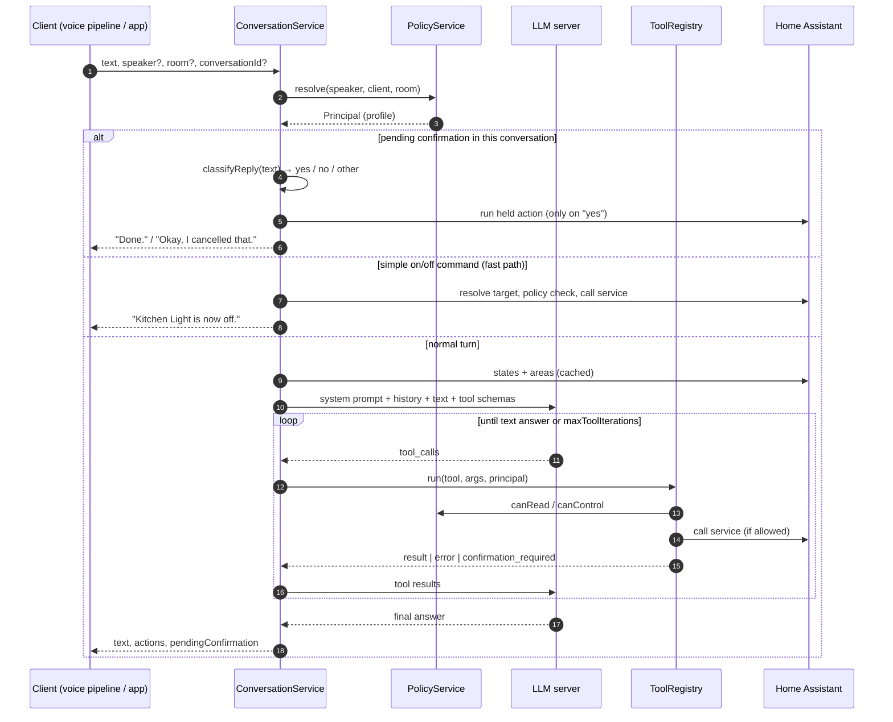

# Architecture

AURA Gateway is a single NestJS service: a modular monolith built from small, swappable modules. It has no database. All state is short-lived and kept in memory.

## Modules

```
src/
├── config/          Env (zod) + aura.config.yaml (zod) → injectable, validated config
├── common/          API-key guard, zod body pipe, upstream error filter, fetch helper
├── health/          /health (liveness), /health/ready (LLM + Home Assistant probes)
├── llm/             LlmClient abstraction + OpenAI-compatible implementation
├── home-assistant/  REST client + EntityDirectory (exposure filter, area lookup, cache)
├── policy/          PolicyService: principal resolution + read/control decisions
├── tools/           ToolRegistry + built-in tools (get_time, ha_list_entities, ha_get_state, ha_call_service)
├── conversation/    ConversationService (the agent loop), fast path, store, prompt, phrases, REST controller
├── events/          EventBus + SSE endpoint /v1/events (lifecycle events for satellites and displays)
├── metrics/         Prometheus registry + /metrics
└── compat/          OpenAI- and Ollama-compatible facades on top of ConversationService
```

Dependencies point inward: `compat → conversation → tools → policy/home-assistant → config`. The LLM is reached only through the abstract `LlmClient`, so tests can use a scripted fake and other backends can be added without touching the loop.

## Request lifecycle



## Design decisions

**Policy lives outside the model.** Prompts are suggestions; code is a guarantee. The LLM only ever sees exposed entities, and every service call is checked again in `HaCallServiceTool` through `PolicyService`. Targets must be explicit `entity_id`s. `area_id`, `device_id` and similar keys are rejected because they would skip per-entity checks.

**Fast path before the LLM.** Most voice requests in a home are "X on/off". A small parser (English and German) matches these and resolves the target by device name or by "lights in this room". It runs only when the command is **unambiguous**: exactly one device, or all lights in a known room. Then it calls Home Assistant directly, after the same policy checks. Anything unclear, and anything in `confirmDomains`, goes to the LLM. The answer comes back in milliseconds instead of seconds.

**Events, not polling.** Every conversation emits `conversation.started`, `tool.executed`, `confirmation.requested`/`resolved` and `conversation.answered` on an in-process bus, exposed as Server-Sent Events. A satellite subscribes with `?room=Kitchen` and drives its light ring or display from it.

**Confirmations are deterministic.** When a tool hits a domain listed in `policy.confirmDomains`, the action is held, not run. The Gateway asks the user with a fixed phrase and runs the action only if the _next_ utterance is a short, clear "yes" (or the client calls `POST /v1/conversation/:id/confirmation`). Anything else drops the action. A model that makes up a confirmation does nothing.

**OpenAI-compatible as the lingua franca.** Ollama, vLLM, llama.cpp, LM Studio, LocalAI and hosted APIs all speak `/v1/chat/completions` with tools. Supporting that one format covers the whole local-model ecosystem. In the other direction, AURA _offers_ OpenAI and Ollama formats so existing clients (Open WebUI, Home Assistant) can use it without custom code.

**Short prompts, short answers.** Most replies are spoken, so the system prompt asks for one or two sentences, no markdown, in the configured language. Small local models follow short prompts more reliably than long ones.

**Inject entities when it's cheap.** If the visible entity list is small (≤ `injectEntitiesLimit`), it goes straight into the prompt. That saves a `ha_list_entities` round trip on most requests. Large homes fall back to tool-based discovery.

**In-memory, TTL-bound state.** Conversations expire after `conversation.ttlSeconds`. Only user and assistant text is kept; tool traffic is not. Restarting the Gateway forgets everything, which suits a household assistant. Durable memory (preferences, routines) is on the [roadmap](../ROADMAP.md) as an opt-in module.

**Why NestJS?** Dependency injection makes tools, LLM backends and policies easy to swap and test. Decorators give OpenAPI docs almost for free, and the TypeScript stack is shared with the rest of AURA (apps, contracts). The Gateway is I/O-bound (waiting on the LLM and Home Assistant), so Node's event loop fits well.

## Where AURA Gateway sits in a home network

- Run it close to Home Assistant and the inference server. Same host or same VLAN keeps latency low.
- Put it behind your reverse proxy if clients connect over TLS. `trust proxy` is set to loopback by default.
- Give each client its own API key. Map keys to profiles with `policy.clients` (for example, wall displays as `readOnly`).
